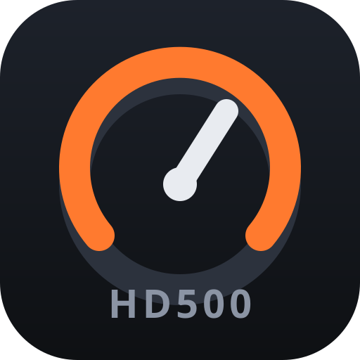
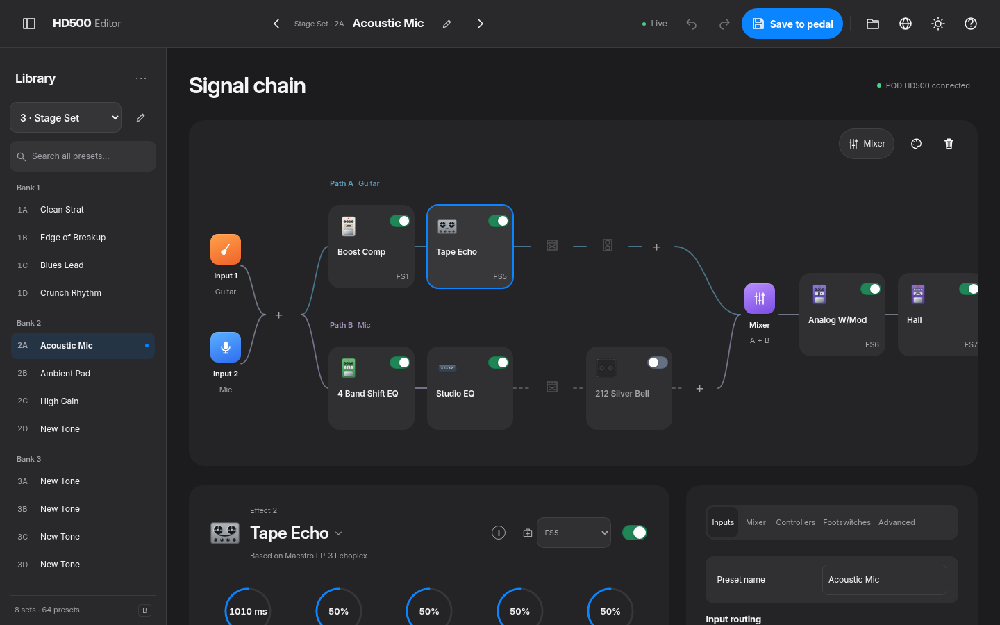

<p align="center"></p>

# HD500 Editor

**A free, open editor for the Line 6 POD HD500** — now that the official software is no longer maintained, the community can keep this pedal alive.
Runs on Linux, Windows and macOS, talks to the pedal directly over USB, and goes beyond the original editor.

🇧🇷 [Leia em português](README.pt-BR.md)



## What you can do

- **Glass signal graph**: drag effects between *before/after the amp* and path **A / B**, see which input feeds which path.
- **Edit everything live**: every amp, cab and effect model (92 amps incl. the optional model packs · 22 cabs · 115 effects, each with its own illustration), all parameters, bypass, footswitch assignment, expression-pedal (EXP 1/2) assignment with heel/toe range.
- **Mixer panel**: level (Mute … +12 dB) and pan of paths A and B with live faders, plus the Trails switch — mirrored in real time when you turn the knobs on the pedal.
- **Input routing**: Guitar, Mic, Aux, Variax and combinations on Input 1 / Input 2, guitar impedance, tempo, Dynamic Tone (topology/class/mode).
- **Footswitch panel**: a virtual footswitch strip that mirrors the pedal in real time — step on FS5 and the block lights up on screen.
- **Preset sidebar** for all 8 sets × 64 presets, with bank groups and search across sets: rename sets, copy, swap, clear, drag-and-drop between slots, **export/import the whole library**, import/export official **`.h5e`** presets, automatic **backups** before every write.
- **Undo / redo**, inline preset naming, unsaved-changes tracking, light and dark glass themes, keyboard navigation and reduced-motion / solid-material fallbacks.
- **Advanced**: every preset setting by id, raw preset bytes, MIDI-assignment records, global pedal settings, and a *Learn* mode that shows which setting you just touched on the pedal — help us name the unknown ones!

## Status

| | Linux | Windows | macOS |
|---|---|---|---|
| Tested on hardware | ✅ | ❌ not yet | ❌ not yet |
| Notes | udev rule (included) | needs a WinUSB driver for the pedal's control interface (Zadig) | expected to work through libusb |

Everything marked ✅ was verified against a real POD HD500 (firmware 2.x). Please open an issue with your results on other systems or firmware versions.

## Install

**Linux** — download the `.AppImage` or `.deb` from the Releases page. The `.deb` installs the udev rule for you. For the AppImage (or running from source) install the rule once:

```sh
sudo cp 99-line6-hd500.rules /etc/udev/rules.d/ && sudo udevadm control --reload
# then unplug and plug the pedal again
```

**Windows** — the Line 6 driver owns the pedal's control interface. Use [Zadig](https://zadig.akeo.ie) to bind the *"POD HD500 (Interface 1)"* to **WinUSB**. (This disables the pedal's USB audio on that interface; keep the official driver if you need audio and use a second profile.) *Untested — feedback welcome.*

**macOS** — download `HD500-Editor-<version>-mac-arm64.dmg` (Apple Silicon) or `-x64.dmg` (Intel). The app is **not signed** (no Apple developer account), so macOS blocks it the first time: open the `.dmg`, drag the app to Applications, then **right-click the app → Open → Open**. If macOS says the app is “damaged”, run once in Terminal: `xattr -cr "/Applications/HD500 Editor.app"`. *Untested on real hardware — feedback welcome.*

**From source** (Node.js ≥ 22):

```sh
git clone https://github.com/OWNER/hd500-editor.git && cd hd500-editor
npm install
npm run app        # desktop window (Electron)
npm start          # or: web UI at http://127.0.0.1:5230
HD500_DEMO=1 npm start   # no pedal? try it with a simulated one
```

## UI development

The interface uses local ES modules, inline SVG symbols and system fonts; it works offline without a build step. Open the library with **B**, search all presets with **L**, and use **Alt + arrows** on an effect to move it by keyboard. Library import/export and set actions live in the sidebar's **…** menu.

Use the simulated pedal for UI work:

```sh
HD500_DEMO=1 PORT=5231 node app/server.mjs
# With the demo running in another terminal:
node tests/ui-smoke.mjs /tmp/hd500-ui
HD500_DEMO=1 node tests/ui-pointer-demo.mjs /tmp/hd500-ui
node tests/screenshots.mjs docs/img
python3 tools/i18n/apply.py
```

Screenshots cover both themes at desktop, tablet and phone sizes; their contact sheet is written to `/tmp/hd500-ui/contact.png` (Pillow required). Design decisions, shortcuts and outstanding visual verification are documented in [UI notes](docs/ui-notes.md).

## Safety

- Edits only touch the pedal's **edit buffer**; nothing is written until you press **Save to pedal**.
- Before any write to the pedal's memory the previous content of the slot is saved in `backups/`. `node tools/restore.mjs <file.bin> <set> <preset>` writes a backup back.
- Switching presets discards unsaved edits — the editor asks first.
- Not affiliated with Line 6 / Yamaha Guitar Group. See [DISCLAIMER](DISCLAIMER.md).

## How it works

The HD500 is not a USB-MIDI device. It exposes a vendor-specific bulk endpoint pair carrying 64-byte packets with a small framing layer and 4 KB preset images. The protocol was reverse-engineered by analysing the last official editor (v2.27) and verified on hardware:

- [`docs/protocol.md`](docs/protocol.md) — transport, framing, commands
- [`docs/preset-format.md`](docs/preset-format.md) — the 4096-byte preset body and the `.h5e` file format
- [`docs/reverse-engineering.md`](docs/reverse-engineering.md) — how we did it, and how to continue

Prior public work by the *lpedit* project (POD HD500X) was a valuable starting point — see [NOTICE](NOTICE).

## Contributing

There is plenty to discover: names for the remaining preset settings, the MIDI-assignment records, L6 Link, Variax and the global settings. See [CONTRIBUTING.md](CONTRIBUTING.md) — a pedal and curiosity are all you need.

## License

MIT (see [LICENSE](LICENSE)). Model/parameter tables in `catalog/` derive from LGPL-3.0 data (see `catalog/NOTICE`).

## MCP (AI editing)
An included MCP server lets an AI assistant read and edit your preset live, safely (edit buffer only, snapshot first, explicit confirm to save). See [docs/mcp.md](docs/mcp.md).
